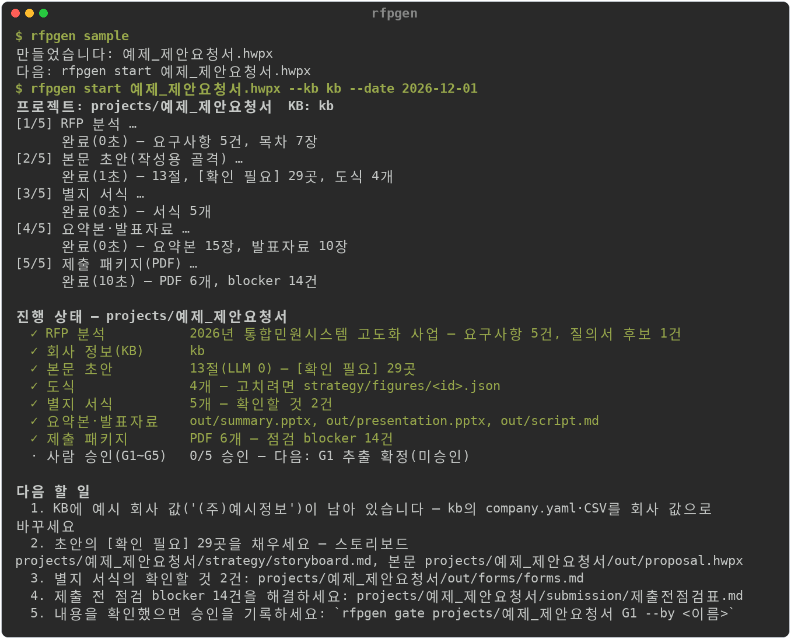
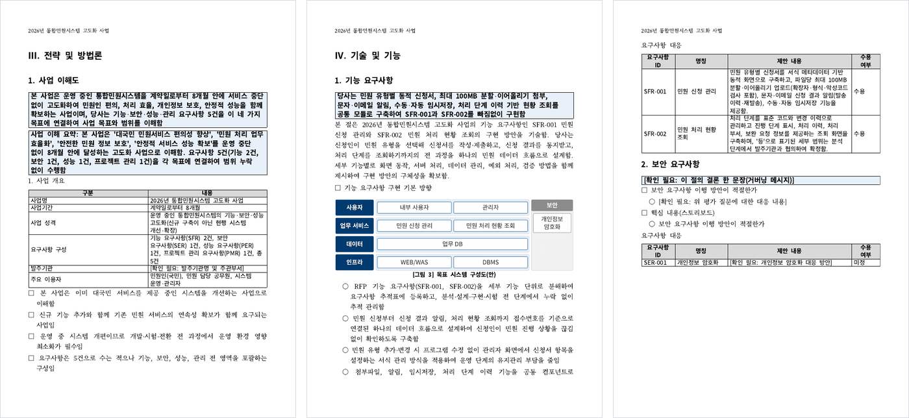
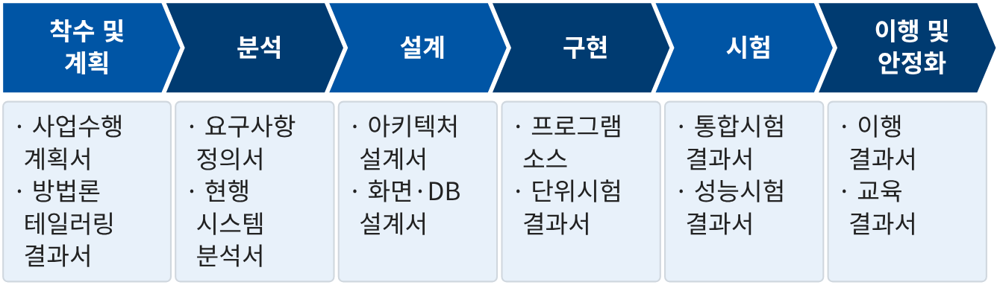
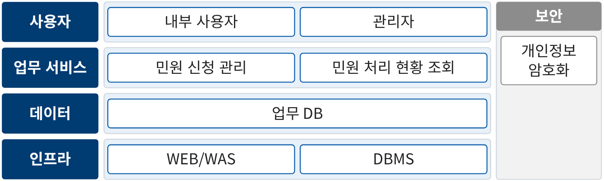
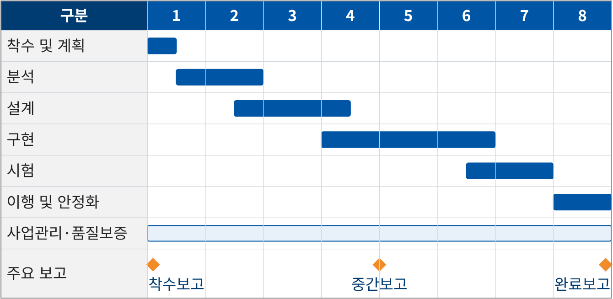
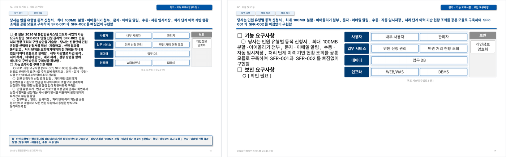
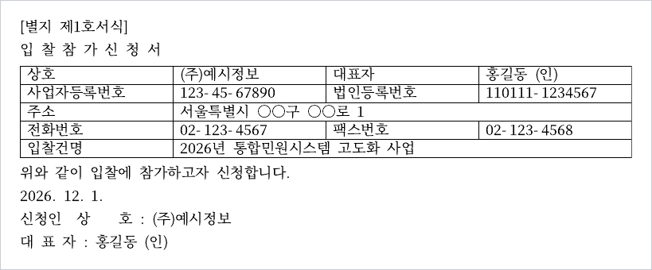
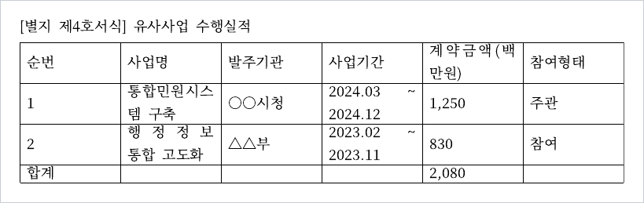
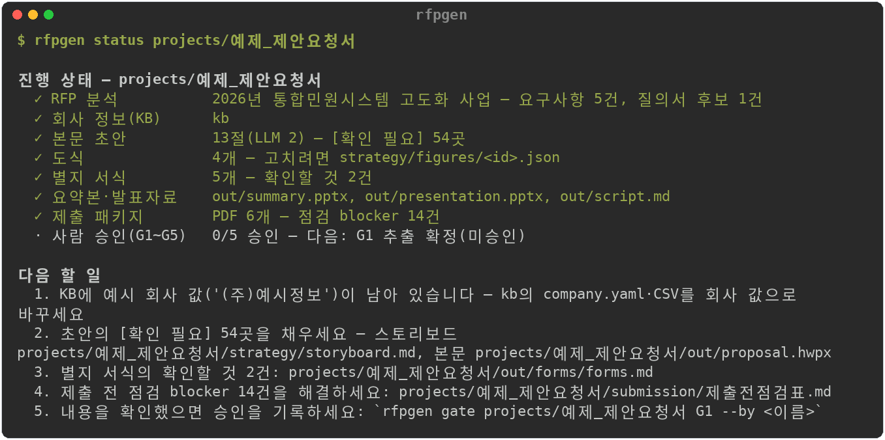
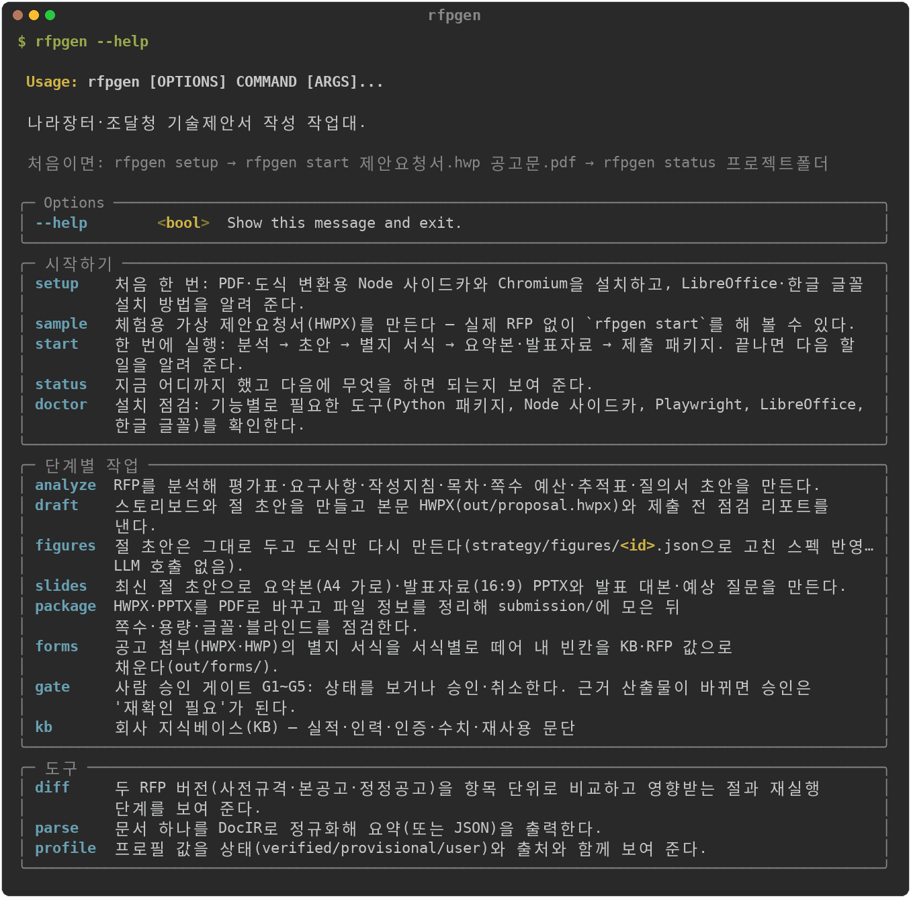

# rfpgen — 나라장터 기술제안서 작성 도우미

나라장터(조달청) **협상에 의한 계약**의 기술제안서를 쓰는 일을 돕는 명령줄 도구입니다. 공고 첨부(제안요청서·공고문)를 넣으면 다음을 만들어 줍니다.

- **분석:** 평가표, 요구사항 목록, 작성지침(쪽수·글자 크기·제출 형식), 입찰무효·감점 사유, 발주기관 질의서 초안
- **초안:** 평가표 순서의 목차와 쪽수 배분, 요구사항 대응표, 본문 초안(HWPX), 도식(일정·조직도·구성도 등)
- **서식:** 공고에 붙은 별지 서식(입찰참가신청서, 실적·인력 현황 등)에 회사 정보를 채운 파일
- **제출 준비:** 요약본·발표자료(PPTX), 제출용 PDF 묶음, 쪽수·용량·블라인드 위반을 확인한 제출 전 점검표

모든 결과는 **사람이 검토하고 고치는 초안**입니다. 근거 없는 수치는 지어내지 않고 `[확인 필요]`로 남기며, 나라장터 업로드와 최종 판단은 사람이 합니다.



<sub>체험용 가상 제안요청서로 `rfpgen sample` → `rfpgen start`를 실행한 화면입니다. 분석·초안·별지·장표·제출 패키지를 차례로 만들고, 끝에 진행 상태와 다음 할 일을 알려 줍니다. 만들어지는 문서는 [결과물 예시](#결과물-예시)에 있습니다.</sub>

---

## 1. 설치 (처음 한 번)

### 방법 A — Docker (설치할 것이 가장 적음)

Windows·macOS·Linux 모두 [Docker Desktop](https://www.docker.com/products/docker-desktop/)만 있으면 됩니다. 이미지 안에 Python, PDF 변환기, LibreOffice, 한글 글꼴이 모두 들어 있습니다.

```bash
git clone https://github.com/BudongJW/auto-rfp-generator.git
cd auto-rfp-generator
docker build -t rfpgen .
```

이후에는 공고 파일이 있는 폴더에서 `rfpgen` 대신 아래처럼 실행합니다(현재 폴더가 컨테이너의 작업 폴더가 됩니다).

```bash
docker run --rm -v "$PWD:/work" rfpgen start 제안요청서.hwp 공고문.pdf
```

- Windows PowerShell은 `-v "${PWD}:/work"`, 명령 프롬프트(cmd)는 `-v "%cd%:/work"`로 씁니다.
- 이 문서의 `rfpgen …` 명령은 모두 `docker run --rm -v "$PWD:/work" rfpgen …`으로 바꿔 쓰면 됩니다.

### 방법 B — 직접 설치

| 준비물 | 용도 | Windows | macOS | Ubuntu·Debian |
|---|---|---|---|---|
| [uv](https://docs.astral.sh/uv/) (Python 3.12+를 알아서 받음) | 프로그램 실행 | `winget install astral-sh.uv` | `brew install uv` | `curl -LsSf https://astral.sh/uv/install.sh \| sh` |
| Node.js 18 이상 | PDF 변환·도식 그림 | `winget install OpenJS.NodeJS.LTS` | `brew install node` | [nodejs.org](https://nodejs.org) 안내 |
| LibreOffice | 요약본·발표자료 PDF | `winget install TheDocumentFoundation.LibreOffice` | `brew install --cask libreoffice` | `sudo apt-get install -y libreoffice-impress` |
| 한글 글꼴(Noto Sans·Serif KR) | PDF·도식 글자 | [Google Fonts](https://fonts.google.com/noto/specimen/Noto+Sans+KR) | [Google Fonts](https://fonts.google.com/noto/specimen/Noto+Sans+KR) | `sudo apt-get install -y fonts-noto-cjk` |

```bash
git clone https://github.com/BudongJW/auto-rfp-generator.git
cd auto-rfp-generator
uv sync
uv run rfpgen setup
uv run rfpgen doctor --full
```

- `rfpgen setup`은 PDF 변환기(Node 사이드카와 Chromium)를 설치하고, 빠진 준비물을 운영체제에 맞는 설치 명령과 함께 알려 줍니다.
- `rfpgen doctor --full`은 한글이 든 작은 문서를 실제로 변환해 보고 기능별로 ✓·!·✗를 보여 줍니다. `!`는 그 기능만 못 쓴다는 뜻이고 나머지는 동작합니다(예: LibreOffice가 없으면 장표 PDF만 빠짐).
- 매번 `uv run`을 붙이기 싫으면 `.venv`를 활성화하세요(Windows `.venv\Scripts\activate`, macOS·Linux `source .venv/bin/activate`).

---

## 2. 5분 체험 — 예제로 해 보기

실제 공고 없이 가상 제안요청서로 전체 흐름을 볼 수 있습니다.

```bash
uv run rfpgen sample
uv run rfpgen start 예제_제안요청서.hwpx
```

`projects/예제_제안요청서/` 폴더가 생기고, 끝에 진행 상태와 **다음 할 일**이 나옵니다. 먼저 열어 볼 파일은 다음과 같습니다.

- `out/analysis.md`: 평가표·요구사항·작성지침 요약
- `out/proposal.hwpx`: 본문 초안(한글에서 열기)
- `submission/제출전점검표.md`: 제출 전 확인 목록

### 결과물 예시

아래는 모두 같은 가상 제안요청서로 만든 결과입니다. 회사 정보는 `rfpgen kb init`의 예시 값이고, 본문 두 절(사업 이해도·기능 요구사항)만 `--llm`으로 Claude가 썼습니다.

**본문 초안** — `out/proposal.hwpx`를 제출용 PDF로 바꾼 쪽입니다. 절 첫머리의 거버닝 메시지 상자, 표, 자동 도식, 절 끝의 요구사항 대응표가 보입니다. 셋째 쪽의 '2. 보안 요구사항'처럼 키 없이 만든 절은 `[확인 필요]`가 든 작성용 골격입니다.



**도식** — RFP의 사업 기간·요구사항과 KB로 그립니다. 내용은 `strategy/figures/<id>.json`으로 고칠 수 있습니다.

<table>
  <tr>
    <td width="50%"></td>
    <td width="50%"></td>
  </tr>
  <tr>
    <td align="center"><sub>추진 절차와 단계별 산출물</sub></td>
    <td align="center"><sub>목표 시스템 구성도(요구사항에서 뽑은 기능·데이터·보안)</sub></td>
  </tr>
  <tr>
    <td colspan="2"></td>
  </tr>
  <tr>
    <td colspan="2" align="center"><sub>사업 추진 일정(사업 기간 8개월에 맞춤)</sub></td>
  </tr>
</table>

**요약본·발표자료** — 평가항목 태그, 요구사항 ID 칩, 거버닝 메시지, 개조식 본문, 도식이 정해진 자리에 놓입니다. 발표 대본은 발표자 노트와 `out/script.md`에 들어갑니다.



**별지 서식** — 공고에 붙은 서식을 서식별 파일로 떼어 KB 값으로 채웁니다. 실적 표는 행을 늘리고 합계를 다시 계산합니다.

<table>
  <tr>
    <td width="55%"></td>
    <td width="45%"></td>
  </tr>
  <tr>
    <td align="center"><sub>입찰참가신청서</sub></td>
    <td align="center"><sub>유사사업 수행실적(합계 자동 계산)</sub></td>
  </tr>
</table>

---

## 3. 실제 공고로 쓰기

### ① 공고 파일 준비

- 나라장터에서 **제안요청서, 공고문, 별지 서식** 첨부를 내려받습니다. HWP·HWPX·PDF·DOCX와 이 파일들을 담은 ZIP을 그대로 넣을 수 있습니다.
- 별지 서식을 채우려면 서식이 **HWP 또는 HWPX**여야 합니다(PDF 서식은 채우지 못함).
- 배포용·암호 HWP는 열지 못합니다. 한글에서 PDF로 저장해 넣으세요. 스캔한 PDF(글자가 이미지)는 읽지 못합니다.

### ② 회사 정보(KB) 만들기

본문의 실적·인원 수치, 별지의 상호·사업자등록번호 등은 **KB 폴더에 적은 값만** 씁니다.

```bash
uv run rfpgen kb init kb
```

예시 파일이 생기면 회사 값으로 바꿉니다.

| 파일 | 적을 내용 |
|---|---|
| `kb/company.yaml` | 상호·대표자·영문명·제품명(블라인드 점검에 쓰임), 사업자등록번호·주소·전화 등 별지용 정보, 근거 있는 수치(`facts`) |
| `kb/projects.csv` | 유사사업 실적(사업명, 발주기관, 기간, 금액, 역할, 기술) |
| `kb/people.csv` | 투입 인력(역할, 등급, 경력, 기술, 자격) — 실명은 넣지 않습니다 |
| `kb/certifications.csv` | 인증(이름, 번호, 유효기간) |
| `kb/content/*.md` | 과거 제안서에서 다시 쓸 문단 |
| `kb/private/people.csv`, `kb/private/forms.yaml` | (선택) 별지 성명 칸용 실명, 생성기가 모르는 별지 칸 값(담당자 등). LLM으로 보내지 않고 저장소에도 올리지 않습니다 |

```bash
uv run rfpgen kb check kb
```

### ③ 한 번에 실행

```bash
uv run rfpgen start 제안요청서.hwp 공고문.pdf 별지서식.hwp --kb kb
```

분석 → 본문 초안 → 별지 서식 → 요약본·발표자료 → 제출 패키지를 차례로 만듭니다. 프로젝트 폴더는 첫 파일 이름을 따서 `projects/제안요청서/`가 됩니다(`-o`로 바꿀 수 있음). 한 번 쓴 KB 폴더는 기억하므로 다음 명령부터 `--kb`를 빼도 됩니다.

### ④ 확인하고 고치기

```bash
uv run rfpgen status projects/제안요청서
```

지금 단계와 다음 할 일을 알려 줍니다.



<sub>예제에서 두 절을 Claude로 다시 쓴 뒤의 상태입니다. LLM도 근거(KB 값)가 없으면 수치를 지어내지 않고 `[확인 필요]`로 남기므로, 채울 자리가 늘어날 수 있습니다.</sub>

주로 이 순서로 손봅니다.

| 확인할 것 | 파일 | 고친 뒤 실행 |
|---|---|---|
| 평가표·요구사항·작성지침이 원문과 맞는지 | `out/analysis.md`, `out/analysis.xlsx` | — |
| 발주기관에 물어볼 모호한 요구사항 | `out/questions.md` | — |
| 장별 핵심 메시지·필요한 근거(스토리보드) | `strategy/storyboard.json`(`.md`는 읽기용) | `rfpgen draft 프로젝트` |
| 본문의 `[확인 필요]` 자리 | `out/proposal.hwpx`, `out/trace_draft.xlsx` | 한글에서 직접 고치거나 KB를 채우고 `rfpgen draft` |
| 도식 내용 | `strategy/figures/<id>.auto.json` → `<id>.json`으로 복사해 수정 | `rfpgen figures 프로젝트` |
| 별지 서식의 빈칸·날인 | `out/forms/forms.md`, `out/forms/*.hwpx` | `rfpgen forms 프로젝트 --date 2026-12-01` |
| 요약본·발표자료 | `out/summary.pptx`, `out/presentation.pptx`, `out/script.md` | `rfpgen slides 프로젝트` |
| 제출 전 점검 | `submission/제출전점검표.md`, `checks/*.md` | `rfpgen package 프로젝트` |

- 일부 절만 다시 쓰려면 `rfpgen draft 프로젝트 --section S-3-1`처럼 절 ID를 줍니다(ID는 `strategy/storyboard.md`에 있음).
- PDF는 서버에서 그린 것이라 한글 화면과 쪽 나눔이 조금 다를 수 있습니다. 최종본은 한글에서 HWPX를 열어 확인하세요.

### ⑤ 승인하고 제출하기

단계마다 사람이 확인했다는 기록을 남깁니다. 내용이 바뀌면 승인은 자동으로 '재확인 필요'가 됩니다.

```bash
uv run rfpgen gate projects/제안요청서
uv run rfpgen gate projects/제안요청서 G1 --by 홍길동
```

G1 분석 확정 → G2 목차·매핑 확정 → G3 전략 확정 → G4 절 승인 → G5 제출 승인(점검 blocker 0건) 순서입니다. 제출은 `submission/` 폴더의 PDF를 나라장터에서 문서구분에 맞게 직접 올립니다. 가격입찰서는 따로 냅니다.

### ⑥ 정정공고가 나오면

같은 프로젝트 폴더로 다시 분석하고 바뀐 점을 봅니다. 바뀐 요구사항·배점·분량과 다시 손볼 절을 알려 줍니다.

```bash
uv run rfpgen analyze 정정_제안요청서.hwp -o projects/제안요청서
uv run rfpgen diff projects/제안요청서
```

---

## 4. Claude로 초안 쓰기 (선택)

API 키가 있으면 분석을 보강하고 본문 문장을 생성합니다. 키가 없어도 다른 기능은 모두 동작합니다(본문은 `[확인 필요]`가 든 작성용 골격으로 나옴).

```bash
export RFP_ANTHROPIC_API_KEY=sk-ant-...
uv run rfpgen start 제안요청서.hwp --kb kb --llm
```

- Windows PowerShell은 `$env:RFP_ANTHROPIC_API_KEY="sk-ant-..."`, Docker는 `docker run -e RFP_ANTHROPIC_API_KEY …`로 넘깁니다.
- **보내는 것:** 공개 RFP 발췌만 보냅니다. 회사 KB의 값은 보내지 않고, 회사 수치는 LLM이 `{{fact:F-001}}` 같은 표시로만 쓰면 프로그램이 KB 값으로 바꿉니다. KB의 항목 이름·재사용 문단까지 보내려면 `--llm-share-kb`를 줍니다.
- **시간·비용(공개 RFP 404쪽 기준 추정):** 분석 보강 약 7~10분·2~3달러, 본문 절당 1~2분·0.2~0.4달러. 자세한 측정은 [LLM 실측 기록](docs/analysis/llm-live-measurement.md)에 있습니다.
- 모든 호출은 `audit/llm_calls.jsonl`에 남습니다. LLM이 낸 값은 원문 인용을 확인한 것만 받고, 모두 '확인 필요(proposed)' 상태로 들어갑니다.
- 모델은 자동으로 최신 Opus 계열을 고르며 `--llm-model`로 바꿀 수 있습니다. 실행별 추정 비용을 보려면 조직 프로필에 단가를 넣습니다([고급 설정](docs/advanced.md)).

---

## 5. 명령 모음

| 명령 | 하는 일 |
|---|---|
| `rfpgen setup` | 처음 한 번, PDF 변환기 설치와 준비물 안내 |
| `rfpgen doctor --full` | 설치 상태 점검 |
| `rfpgen sample` | 체험용 가상 제안요청서 만들기 |
| `rfpgen start 파일들 [--kb kb] [--llm]` | 분석부터 제출 패키지까지 한 번에 |
| `rfpgen status 프로젝트` | 진행 상태와 다음 할 일 |
| `rfpgen kb init kb` / `kb check kb` | 회사 정보 예시 만들기 / 점검 |
| `rfpgen analyze 파일들 -o 프로젝트` | RFP 분석만 |
| `rfpgen draft 프로젝트 [--llm] [--section ID]` | 스토리보드·본문 초안(HWPX) |
| `rfpgen figures 프로젝트` | 도식만 다시 만들기 |
| `rfpgen forms 프로젝트 [--date YYYY-MM-DD]` | 별지 서식 채우기 |
| `rfpgen slides 프로젝트` | 요약본·발표자료·발표 대본 |
| `rfpgen package 프로젝트` | 제출용 PDF와 제출 전 점검표 |
| `rfpgen gate 프로젝트 [G1~G5 --by 이름]` | 승인 상태 보기·기록 |
| `rfpgen diff 프로젝트` | RFP 판 비교(정정공고) |
| `rfpgen profile` | 배점·쪽수 등 제도 기준값과 근거 법령 |

명령마다 `--help`로 옵션을 볼 수 있습니다(예: `rfpgen draft --help`).

<details>
<summary><code>rfpgen --help</code> 화면 보기</summary>



</details>

---

## 6. 결과물 위치

`projects/<이름>/` 아래에 생깁니다.

| 폴더·파일 | 내용 |
|---|---|
| `out/analysis.md`, `out/analysis.xlsx` | 분석 요약, 요구사항 추적표·평가표·작성지침·무효·감점 사유 시트 |
| `out/questions.md` | 발주기관 질의서 초안 |
| `strategy/storyboard.md` | 장별 핵심 메시지와 필요한 근거 |
| `out/proposal.hwpx` | 본문 초안(A4 세로, 개조식) |
| `out/trace_draft.xlsx` | 요구사항별 대응 방안과 자료 요청서 |
| `out/figures/` | 도식 그림(SVG·PNG) |
| `out/forms/` | 채운 별지 서식(서식별 HWPX)과 확인할 것 |
| `out/summary.pptx`, `out/presentation.pptx`, `out/script.md` | 요약본, 발표자료, 발표 대본·예상 질문 |
| `submission/` | 제출용 PDF(파일 이름에 회사명 없음)와 제출 전 점검표 |
| `checks/` | 단계별 점검 결과 |

---

## 7. 문제가 생기면

| 증상 | 해결 |
|---|---|
| 무엇이 빠졌는지 모르겠음 | `rfpgen doctor --full` |
| "PDF 변환기가 없습니다" | `rfpgen setup` 실행(Node 18 이상 필요) |
| 요약본·발표자료 PDF만 안 나옴 | LibreOffice 설치(1장 표). 설치 위치가 특이하면 `RFPGEN_SOFFICE`에 실행 파일 경로 |
| PDF 글자가 다른 글꼴로 나옴 | 한글 글꼴(Noto Sans·Serif KR) 설치 |
| 이미 설치된 Chrome을 쓰고 싶음 | `RFPGEN_CHROMIUM_PATH`에 실행 파일 경로를 주고 `rfpgen setup --no-browser` |
| "HWP 변환 실패" | 배포용·암호 문서입니다. 한글에서 PDF로 저장해 넣으세요 |
| 쪽수 상한 등을 "읽지 못함" | PDF 안의 숫자가 그림·도형입니다. `out/analysis.md`의 해당 항목을 원문을 보고 직접 확인하세요 |
| 별지 서식을 못 찾음(FORM-MISSING) | 서식이 PDF로만 왔거나 표지 줄(`[별지 제N호서식]`)이 다릅니다. HWP 원본을 넣으세요 |
| `--llm`이 인증 오류 | `RFP_ANTHROPIC_API_KEY`가 설정됐는지 `rfpgen doctor`로 확인 |
| Docker로 만든 파일을 지우거나 고칠 수 없음(Linux) | `sudo chown -R $USER projects` |

---

## 8. 알아 둘 한계

- 실제 공고로 검증한 것은 아직 공개 RFP 몇 건입니다. 분석 결과(특히 평가표·요구사항 수)는 원문과 대조하세요. `out/analysis.md`의 '점검 결과'에 의심 항목이 나옵니다.
- 별지 서식 채우기는 서식 모양이 다양해 못 채우는 칸이 있을 수 있습니다. `out/forms/forms.md`에 남습니다.
- 도식은 RFP·KB와 일반 템플릿으로 만든 초안입니다. 일정 구간·산출물·인프라 구성은 수행계획에 맞게 고치세요.
- 제도 기준값(협상적격 85%, 기술:가격 90:10, 부문 30점 상한, PDF·300MB 등)은 법령·행정규칙 원문과 대조했습니다([대조 기록](docs/analysis/m0-source-check.md)). RFP에 다른 값이 있으면 RFP 값을 씁니다.

---

## 9. 더 알아보기

- 환경변수·설정 파일·산출물 형식: [docs/advanced.md](docs/advanced.md)
- 설계와 결정 사항: [docs/design.md](docs/design.md)
- 조사 보고서: [reports/](reports/), 외부 코드 분석: [docs/analysis/](docs/analysis/)
- 개발: `uv run pytest`로 테스트합니다(변환기가 없으면 렌더 테스트는 건너뜀). GitHub Actions가 단위 테스트, 렌더 경로, Docker 이미지를 확인합니다.

## 라이선스

코드는 GPL-3.0입니다(`LICENSE`). `src/rfpgen/_third_party/agpl/` 아래 파일은 AGPL-3.0 저작물(OpenBidKit_Yibiao, BidMaster-Pro)을 번안한 것으로 AGPL-3.0-only 조건을 따르며, 원 라이선스와 저작자 고지는 [third_party/](third_party/)에 있습니다. 이 프로그램을 웹 서비스로 제공하면 이용자에게 전체 소스를 제공해야 합니다(설계서 11.2절). 문서 서식·도식 템플릿(`src/rfpgen/config/styles`, `config/diagrams`)은 CC0입니다.
